# Twitter SuperApp

A Twitter clone that grew into a SuperApp: tweet, reply, like, Retweet and
bookmark, then tip a Tweet, pay a friend in a chat, order lunch straight from
a Tweet, book a ride across Ankara and post a story, all in one app.

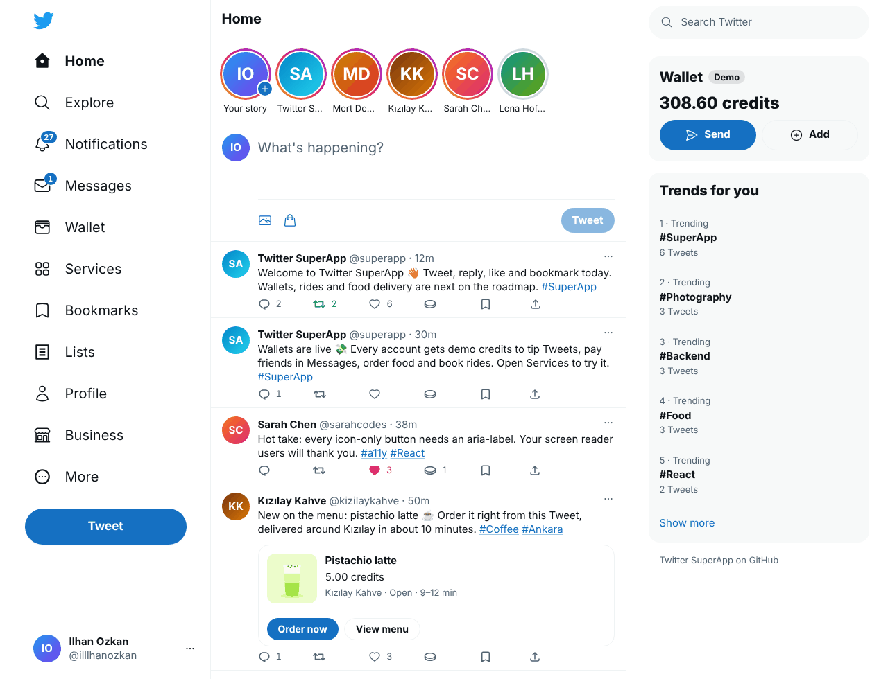

| Lights out                                                                                                                      | Phone                                                                                                                                       |
| ------------------------------------------------------------------------------------------------------------------------------- | ------------------------------------------------------------------------------------------------------------------------------------------- |
| 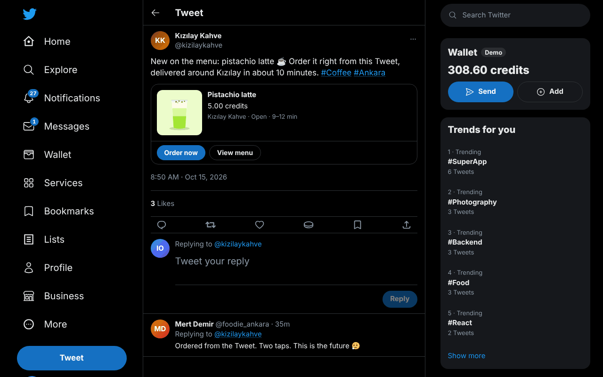 | 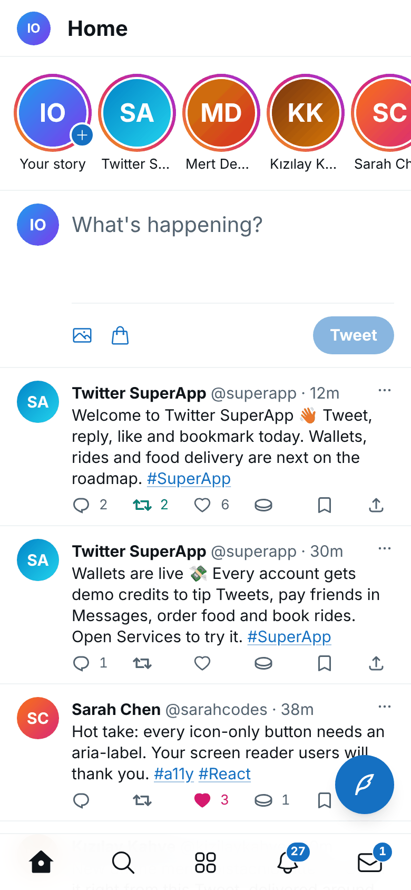 |

> **Demo credits, not money.** Every balance in the app is in demo credits.
> They have no cash value: they can't be bought, withdrawn or exchanged, and
> there is no payment processor anywhere. Businesses, drivers and plates are
> fictional; places are public Ankara landmarks with approximate
> coordinates.

## App Mission

This app aims to turn Twitter into a SuperApp.

## Features

### Twitter

- **Tweet** from the home composer or the compose dialog (`n`): 280 characters counted the
  way people see them, an optional image URL or a product from a business's menu, and
  `Ctrl`/`⌘` + `Enter` to send.
- **Talk**: reply on a tweet's own page, like, Retweet, bookmark, copy a link, and delete
  your own tweets. Reactions update instantly and roll back if the server says no.
- **Discover**: search tweets by text, username or name, trends computed from real
  #hashtags, profiles with Tweets and Likes tabs, and notifications for likes, Retweets,
  replies, tips, payments, orders and rides.
- **Read it your way**: light, "Lights out" and automatic themes, layouts for phones,
  tablets and desktops, full keyboard support (`?` lists the shortcuts, which can be
  turned off), and WCAG AA colors. All main pages are checked with axe in both themes.
- **Runs anywhere**: zero configuration with the bundled demo data, or backed by
  [Sanity](https://www.sanity.io) with its own Studio for editing and moderation.

### SuperApp

**Services** (`/services`) gathers everything below: the wallet, a tile for each
feature, and "Happening now", the orders and rides in progress, which every other page
shows too.

- **Wallet and tips.** Every account has a wallet of demo credits: add credits for
  free, send and request them, and tip a Tweet from its action bar. Every movement has
  a receipt that leads back to the Tweet, chat, order or ride it was for.
  [More](./docs/features/wallet.md)
- **Messages with payments.** Direct conversations where you can send credits, ask
  for them and pay a request without leaving the chat, and share Tweets.
  [More](./docs/features/messages.md)
- **Channels.** Public group conversations: anyone can read them, members post, and
  owners and moderators keep them tidy. [More](./docs/features/channels.md)
- **Business accounts and menus.** Businesses have hours, delivery fees and a menu;
  the people who run one switch "Accepting orders" and sold-out items, and any Tweet
  can carry a product card. [More](./docs/features/shop.md)
- **Food ordering.** "Order now" from a product card, or fill a cart from a menu and
  check out, then follow the order to your door. Cancelled orders are refunded in
  full, and businesses run theirs from a Business board with a demo customer bot.
  [More](./docs/features/orders.md)
- **Rides.** Book a trip between Ankara landmarks at a fixed fare, watch the car on a
  schematic map, cancel for free until pickup, and tip the driver afterwards.
  [More](./docs/features/rides.md)
- **Stories.** Short texts and photos that disappear after 24 hours: a tray on Home, a
  full-screen viewer, who watched (for the author only), and replies that arrive as
  direct messages. [More](./docs/features/stories.md)

How they are built (one demo-credit ledger, privacy, feature switches) is in
[docs/SUPERAPP.md](./docs/SUPERAPP.md).

### Screenshots

|              | Desktop                                                                                                                                                                       | Phone                                                                                                                                                                                            |
| ------------ | ----------------------------------------------------------------------------------------------------------------------------------------------------------------------------- | ------------------------------------------------------------------------------------------------------------------------------------------------------------------------------------------------ |
| **Wallet**   | 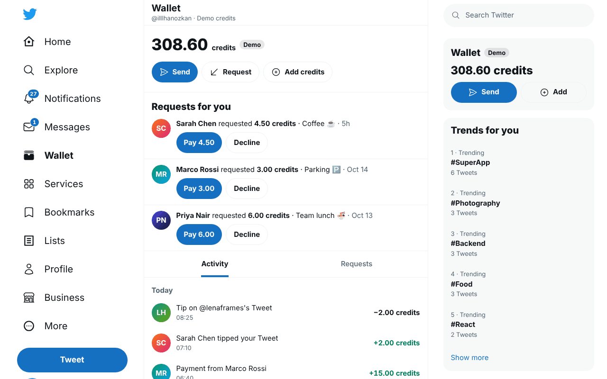 | 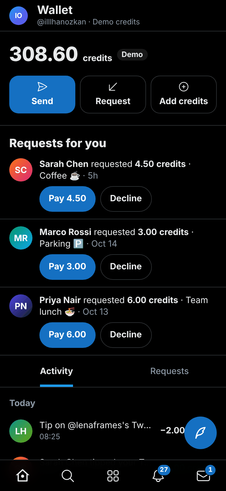                            |
| **Food**     | 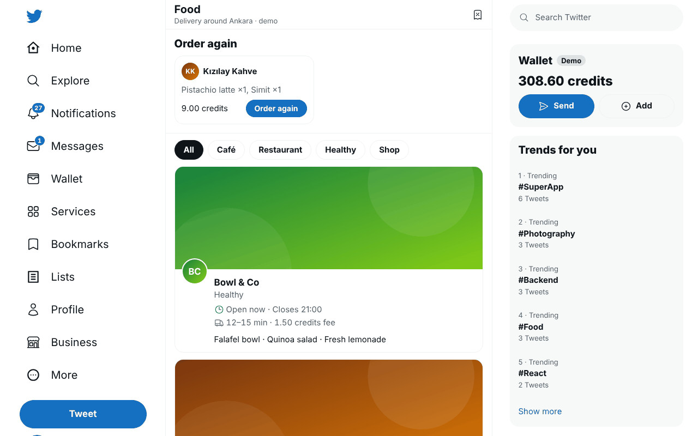                                              | 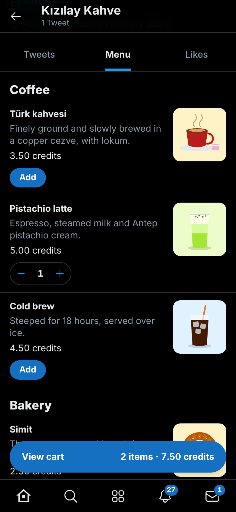                     |
| **Rides**    | 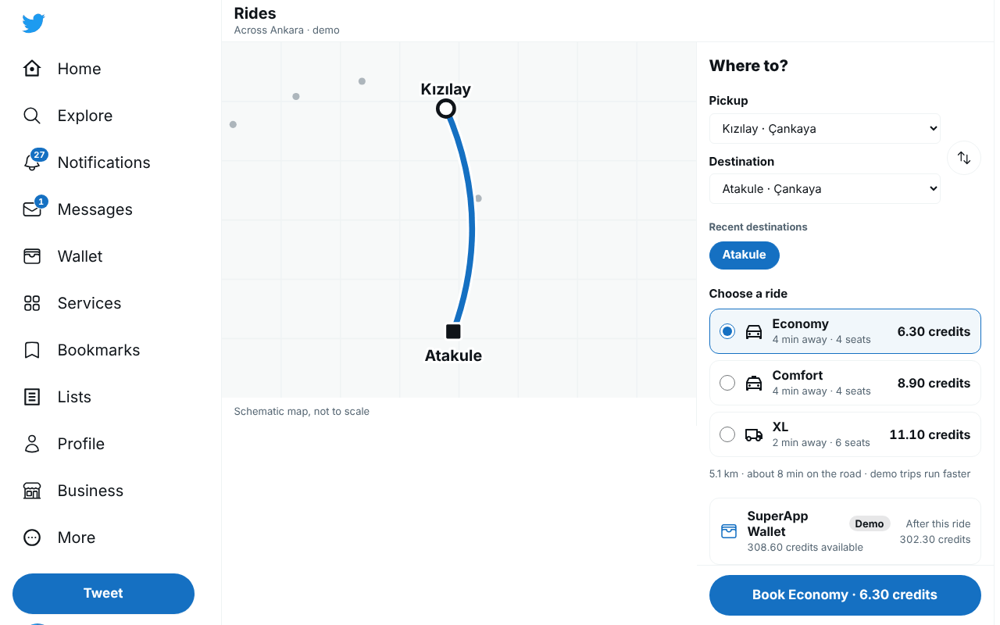   | 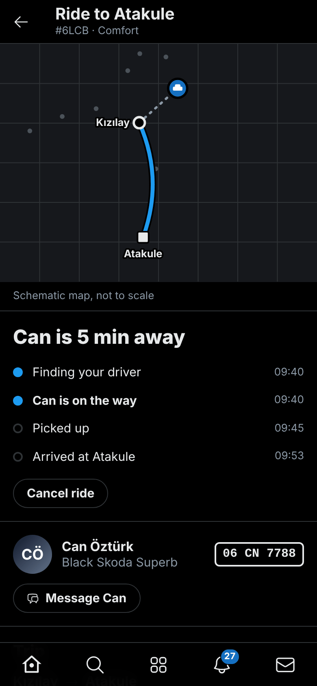 |
| **Messages** | 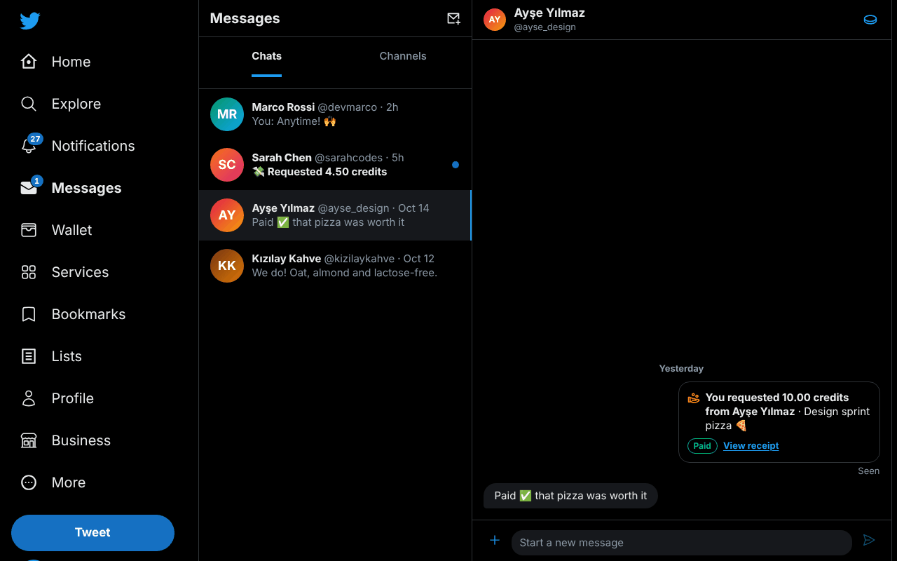                                | 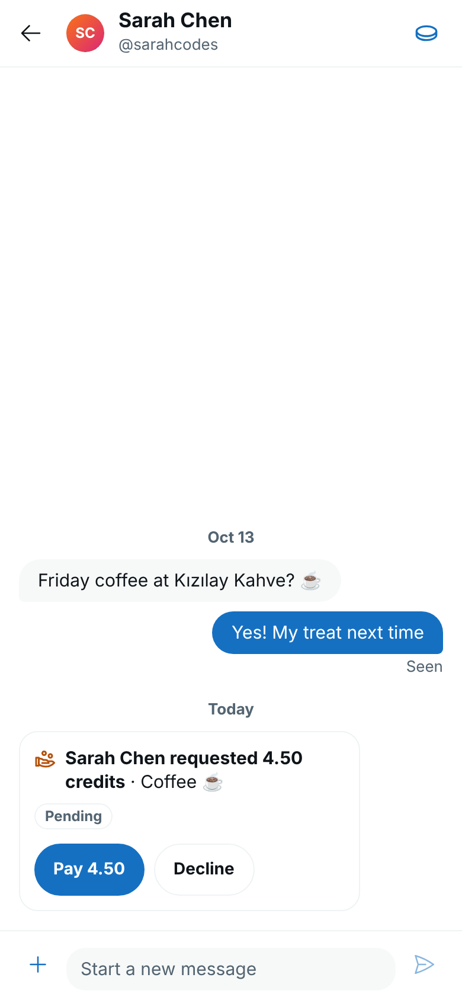                             |

## Getting started

Requires Node.js 22.12 or newer (see `.nvmrc`).

```bash
npm ci
npm run dev   # http://localhost:3000
```

No configuration is needed: without Sanity credentials the app runs on a bundled
in-memory demo dataset: 16 accounts (people, four businesses and four drivers), 26
tweets plus one hidden by moderation, replies and reactions, menus, orders, a ride,
stories, conversations, two channels and a wallet for everyone. You act as
`@illlhanozkan`, who has 308.60 demo credits. Changes you make are kept until the
server restarts.

### Scripts

| Script                         | What it does                                                       |
| ------------------------------ | ------------------------------------------------------------------ |
| `npm run dev`                  | Development server                                                 |
| `npm run build`                | Production build                                                   |
| `npm start`                    | Serves the production build                                        |
| `npm run lint`                 | ESLint (Next.js core web vitals + TypeScript rules)                |
| `npm run format`               | Prettier (with Tailwind class sorting); `format:check` in CI       |
| `npm run typecheck`            | TypeScript check                                                   |
| `npm test`                     | Unit, component and repository contract tests (Vitest)             |
| `npm run test:e2e`             | End-to-end and accessibility tests (Playwright + axe)              |
| `npm run seed:sanity`          | Exports the demo dataset as NDJSON for a Sanity import             |
| `npm run audit:ledger`         | Checks the demo-credit ledger's invariants (Sanity: needs a token) |
| `npm run check:sanity-privacy` | Fails if private Sanity documents are readable without a token     |

`npm run test:e2e` runs against `npm run build` output. The first run needs a browser:
`npx playwright install chromium`. It starts three servers on the in-memory store (the
demo user, a second user and a read-only demo), on `E2E_PORT` (default 3005) and the
two ports after it. CI runs it in three shards (`npx playwright test --shard=1/3` and so
on), each with its own build and servers.

## Architecture

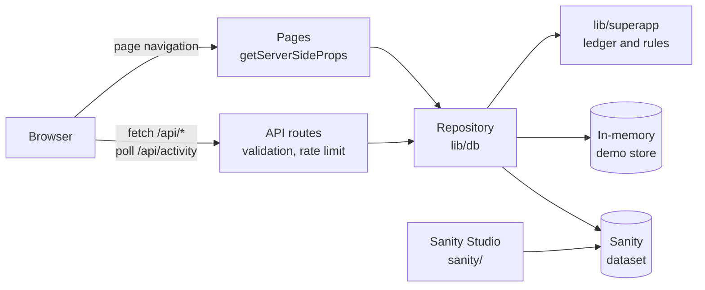

| Path                      | What lives there                                                                                 |
| ------------------------- | ------------------------------------------------------------------------------------------------ |
| `pages/`                  | Routes; `pages/api/` is the REST API                                                             |
| `components/`             | UI: `layout/`, `tweet/`, `profile/`, `common/`, and a folder per SuperApp feature                |
| `slices/`, `store.ts`     | Redux Toolkit state (tweets, timelines, replies, session, UI) and a slice per SuperApp feature   |
| `lib/db/`                 | Repository interface with Sanity and in-memory implementations, a sub-repository per feature     |
| `lib/superapp/`           | SuperApp rules both stores share: money, the ledger, limits, timelines, authorization policies   |
| `lib/api/`, `lib/auth.ts` | API handler wrapper, validation, rate limiting, idempotency, current user                        |
| `lib/server/`             | Server data for pages (`withPageState`) and the app shell                                        |
| `sanity/`                 | Sanity Studio v6 (content model, moderation)                                                     |
| `e2e/`                    | Playwright end-to-end and accessibility tests                                                    |
| `docs/`                   | The REST API, the SuperApp architecture, and an API page and a feature page per SuperApp feature |

### Frontend

Next.js 16 (pages router) with React 19, Redux Toolkit and Tailwind CSS.

- Every page renders on the server: `getServerSideProps` reads the repository directly
  (`lib/server/pageState.ts`) and hands the data to the Redux store as `initialState`,
  so the first paint already contains the timeline.
- Client-side changes go through the REST API with optimistic updates that settle on the
  latest click. Anything that moves credits waits for the server instead, and a retry
  sends the same idempotency key, so nothing is paid twice.
- Orders, rides and chats update by polling while the page is visible; nothing runs
  in the background on the server.
- Colors are CSS variables (`styles/globals.css`) with a light and a dark set; an inline
  script applies the saved theme before the first paint. Text colors meet WCAG AA (4.5:1).
- Layout follows Twitter's breakpoints: full sidebar from 1280px, an icon rail below,
  the right column from 1024px, and a bottom tab bar on phones.

### Data

All reads and writes go through one repository interface (`lib/db/types.ts`) with two
implementations, chosen by `DATA_SOURCE`:

| Source   | When it is used                             | Notes                                                                               |
| -------- | ------------------------------------------- | ----------------------------------------------------------------------------------- |
| `memory` | Default when `SANITY_PROJECT_ID` is not set | Seeded from `lib/db/seed.ts`. Per process, so not for serverless production         |
| `sanity` | Default when `SANITY_PROJECT_ID` is set     | Reads without the CDN so new tweets show up at once. Writes need `SANITY_API_TOKEN` |

The same contract test suites (`lib/db/*.contract.test.ts`) run against both: the
Sanity implementation executes its real GROQ queries with
[groq-js](https://github.com/sanity-io/groq-js) through a fake client, and tests check
that both stores return the same results for the same reads, down to the whole seeded
world (`lib/db/world.test.ts`). Search works like GROQ's `match` in both: every word of
the query must start a word in the tweet, the username or the name.

The Sanity Studio lives in [`sanity/`](./sanity/README.md).

### API

The app talks to a REST API under `/api`: tweets, replies, likes, Retweets, bookmarks,
users, notifications and trends, plus the wallet, conversations, channels, businesses,
orders, rides and stories. Every request acts as the account in `DEMO_USERNAME`,
decided on the server; writes are validated, rate limited and same-origin only, and
requests that move credits need an `Idempotency-Key`. See [docs/API.md](./docs/API.md).

The SuperApp features share one demo-credit ledger and a set of extension points,
described in [docs/SUPERAPP.md](./docs/SUPERAPP.md).

## Deployment

All settings are environment variables (see `.env.example`):

| Variable               | Purpose                                                                                                                                                                                                                                                                                                                      |
| ---------------------- | ---------------------------------------------------------------------------------------------------------------------------------------------------------------------------------------------------------------------------------------------------------------------------------------------------------------------------- |
| `DATA_SOURCE`          | `memory` or `sanity` (default: `sanity` when a project id is set)                                                                                                                                                                                                                                                            |
| `SANITY_PROJECT_ID`    | Sanity project; `SANITY_DATASET` defaults to `production`                                                                                                                                                                                                                                                                    |
| `SANITY_API_TOKEN`     | Token for writes and private data (server-side only); without it Sanity is read-only and the private SuperApp features are off                                                                                                                                                                                               |
| `DEMO_USERNAME`        | The account every visitor acts as (default `illlhanozkan`)                                                                                                                                                                                                                                                                   |
| `READ_ONLY`            | `true` rejects all writes and hides write controls                                                                                                                                                                                                                                                                           |
| `WRITE_RATE_LIMIT`     | Writes per client per minute (default 30); `0` disables it and the per-user SuperApp budgets                                                                                                                                                                                                                                 |
| `SUPERAPP_TIME_SCALE`  | Speeds up new orders and rides for demos: an integer from 1 (real time, the default) to 600. Cancelling stays possible for at least 15 s (orders) and 30 s (rides). The e2e suite uses 60                                                                                                                                    |
| `DISABLED_FEATURES`    | Kill switch: any of `wallet`, `messages`, `channels`, `shop`, `orders`, `rides`, `stories`, separated by commas or spaces. Their pages and API answer 404 and the app hides them (Messages keeps its tab and says it is off). Orders also turns off with `shop` or `wallet`, rides with `wallet`. Unknown names are an error |
| `TRUST_PROXY`          | Behind a reverse proxy: trust the hop it appends to `X-Forwarded-For`                                                                                                                                                                                                                                                        |
| `NEXT_PUBLIC_SITE_URL` | Public URL, used for absolute link-preview (Open Graph) image URLs                                                                                                                                                                                                                                                           |

> **There is no sign-in yet.** Every visitor acts as `DEMO_USERNAME`, so a public
> deployment backed by Sanity with a write token lets anyone post as that account and
> spend its demo credits. Issuing credits is capped and per-user budgets apply, but
> set `READ_ONLY=true` for public demos until authentication is added.

The in-memory store lives in one server process, so use it for local development,
demos and previews; use Sanity for anything that has to persist.

### SuperApp data on Sanity is private

Wallets, transfers, payment requests, orders, rides, story views and conversations
are stored as **private documents** (ids starting with `private.`), which Sanity only
returns to requests with a token, even from a public dataset. So:

- The wallet, messages, channels, orders and rides need `SANITY_API_TOKEN`. Without
  it they are turned off (their API answers 503) rather than shown half-working.
- A private dataset adds a second layer; the app then needs the token for every read.
- After deploying, run `npm run check:sanity-privacy`: it queries the project
  without a token and fails if anything private comes back.
- Importing the demo data (`npm run seed:sanity`) needs a token too, and direct
  messages are stored unencrypted. See [sanity/README.md](./sanity/README.md#privacy).

## Roadmap

The SuperApp features this project set out to build:

- [x] Twitter accounts have balance. ([Wallet](./docs/features/wallet.md))
- [x] Orders can be made via Tweets. ([Orders](./docs/features/orders.md))
- [x] Payment can be made via Twitter chat. ([Messages](./docs/features/messages.md))
- [x] Business account type created for businesses. ([Businesses](./docs/features/shop.md))
- [x] Food delivery and ordering services created. ([Orders](./docs/features/orders.md))
- [x] Trips can be made with a driver booking (like Uber). ([Rides](./docs/features/rides.md))
- [x] Users can create stories (like Twitter Fleets). ([Stories](./docs/features/stories.md))
- [ ] Live broadcasts are possible (like TikTok, Instagram, Twitch). They need a video
      streaming service, which this demo doesn't include:
      [how they would be added](./docs/SUPERAPP.md#live).
- [x] Group chat channels added (like Discord, Telegram). ([Channels](./docs/features/channels.md))

Still missing: sign-in (every visitor acts as `DEMO_USERNAME`), follows (Home shows
everyone's Tweets) and Lists (the Lists page is a placeholder).
